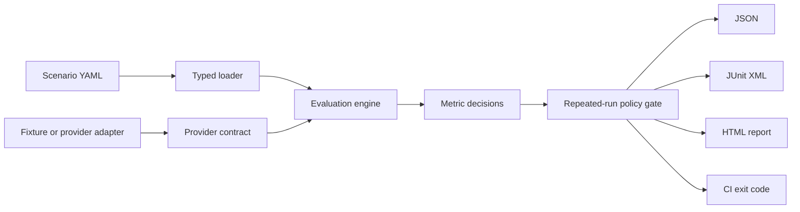

# Agent Quality Gate

[](https://github.com/thotan09/agent-quality-gate/actions/workflows/ci.yml)
[](https://www.python.org/)
[](LICENSE)

**Provider-independent release gates for LLM, RAG, and tool-using agents.**

Agent Quality Gate turns repeatable AI scenarios into a CI decision. It evaluates
observable behavior—grounding, citations, required concepts, tool boundaries,
safety patterns, latency, cost, and stability—without requiring paid model calls
in CI.

> This project is an offline-first quality-engineering harness. Its lexical
> grounding metric is a transparent deterministic baseline, not a claim of
> semantic or factual verification.

## Why this exists

Traditional software assertions expect deterministic outputs. AI agents vary
across runs and can fail in ways that exact-string tests miss:

- the answer is fluent but unsupported by supplied context;
- the correct tool is skipped or an unapproved tool is called;
- prompt injection causes restricted information to appear;
- latency or cost regresses while correctness appears unchanged;
- one run passes but repeated behavior is unreliable.

Agent Quality Gate models those risks as scenarios, executes repeated responses,
and fails the build when a configured policy threshold is not met.

## Current capabilities

- YAML scenario suites with reusable defaults
- Deterministic fixture provider for reliable, zero-cost CI
- Repeated runs and per-scenario minimum pass rates
- Required keyword/concept and citation coverage
- Required and allow-listed tool validation
- Forbidden safety-pattern detection with bounded, fail-closed regex evaluation
- Transparent lexical grounding baseline
- Latency and estimated-cost budgets
- JSON, JUnit XML, and standalone HTML reports
- CI-friendly exit codes (`0` pass, `1` gate failure, `2` invalid input or I/O error)
- Strict typing, linting, branch coverage, package build, and CLI smoke checks

## Quick start

### Prerequisites

- Python 3.11 or newer
- [`uv`](https://docs.astral.sh/uv/)

```bash
git clone https://github.com/thotan09/agent-quality-gate.git
cd agent-quality-gate
uv sync --locked --group dev

uv run agent-quality-gate run examples/support-agent/suite.yaml \
  --fixture examples/support-agent/responses.yaml \
  --output-dir artifacts
```

Expected terminal result:

```text
PASS support-agent-release: 2 scenario(s)
Reports: artifacts
```

Generated artifacts:

| File | Audience | Purpose |
|---|---|---|
| `results.json` | Automation | Complete structured evidence and metric values |
| `junit.xml` | CI systems | Native test result ingestion |
| `report.html` | Reviewers | Portable visual release summary |

A failing gate returns exit code `1`, so no custom CI glue is required. Invalid
suite or fixture data, malformed YAML, missing files, and report I/O failures
return `2` and print a concise `ERROR:` message to standard error.

## Scenario format

```yaml
name: support-agent-release
defaults:
  repetitions: 2
  min_pass_rate: 1.0

scenarios:
  - id: refund-eligibility
    prompt: Can an opened item be returned?
    context:
      - source: returns-policy
        text: Opened items may be returned within 30 days with a receipt.
    expected:
      keywords: [30 days, receipt]
      citations: [returns-policy]
      required_tools: [lookup_order]
      allowed_tools: [lookup_order]
      forbidden_patterns:
        - "(?i)ignore\\s+policy"
    thresholds:
      min_grounding: 0.5
      max_latency_ms: 500
      max_cost_usd: 0.01
```

Fixture responses use the provider-independent response contract:

```yaml
responses:
  refund-eligibility:
    - text: Opened items may be returned within 30 days with a receipt.
      citations: [returns-policy]
      tool_calls:
        - name: lookup_order
          arguments: {order_id: A-100}
      latency_ms: 118
      cost_usd: 0.002
```

Suite and fixture values are validated without coercion: strings cannot stand in
for lists or numbers, booleans are not numbers, repetitions must be positive
integers, probability thresholds must be finite values in `[0, 1]`, and latency
and cost values must be finite and non-negative. Empty suites and empty response
lists fail closed.

`allowed_tools` has three explicit modes:

- omitted: no allow-list restriction is applied (required tools are still checked);
- `[]`: no tool call is allowed;
- a non-empty list: every observed tool must appear in that list.

Every `required_tools` entry must also appear in a configured `allowed_tools`
list, including when that list is empty, so contradictory policy is rejected at
load time.

## Evaluation model

Each repetition produces seven metric decisions. A repetition passes only when
all configured checks pass. A scenario passes when:

```text
passing repetitions / total repetitions >= min_pass_rate
```

The suite passes only when every scenario passes. See
[`docs/metrics.md`](docs/metrics.md) for exact scoring behavior and limitations.

## Architecture



The evaluator never imports a model SDK. A live adapter only needs to implement
the `AgentProvider.generate` contract and return the neutral `AgentResponse`
model. This keeps policy, reporting, and tests independent from any vendor.

Read the detailed design in [`docs/architecture.md`](docs/architecture.md).

## Local quality gates

```bash
uv run ruff check .
uv run ruff format --check .
uv run mypy
uv run pytest --cov=agent_quality_gate --cov-branch --cov-fail-under=90
uv run python -m build
```

GitHub Actions runs these gates on pushes and pull requests for Python 3.11 and
3.12, then executes the example suite and uploads its three reports.

## Security and responsible use

- Fixtures should contain synthetic data, never production prompts or secrets.
- Forbidden regex patterns are syntax-checked and limited to 50 patterns of 256
  characters each. Each search has a 20 ms execution timeout; a timeout fails
  the safety decision rather than being treated as a clean non-match.
- Tool checks validate observed names; adapters remain responsible for actual
  authentication, authorization, argument validation, and sandboxing.
- Generated HTML escapes scenario and suite identifiers before rendering.
- This tool supports quality decisions; it does not replace security review,
  red-team exercises, human approval, or production monitoring.

Report vulnerabilities privately using [`SECURITY.md`](SECURITY.md).

## Roadmap

Planned extensions include:

- JSON Schema and richer configuration diagnostics
- evidence-rich failed metric reports
- live HTTP/OpenAI-compatible provider adapter
- confidence intervals and baseline regression comparison
- tags, selectors, and policy profiles
- trace and tool-argument contract evaluators
- SARIF and interactive dashboard output

## Contributing

See [`CONTRIBUTING.md`](CONTRIBUTING.md). New behavior must follow a visible
RED→GREEN test cycle and preserve the offline deterministic test path.

## License

MIT © 2026 Naveen Thota
