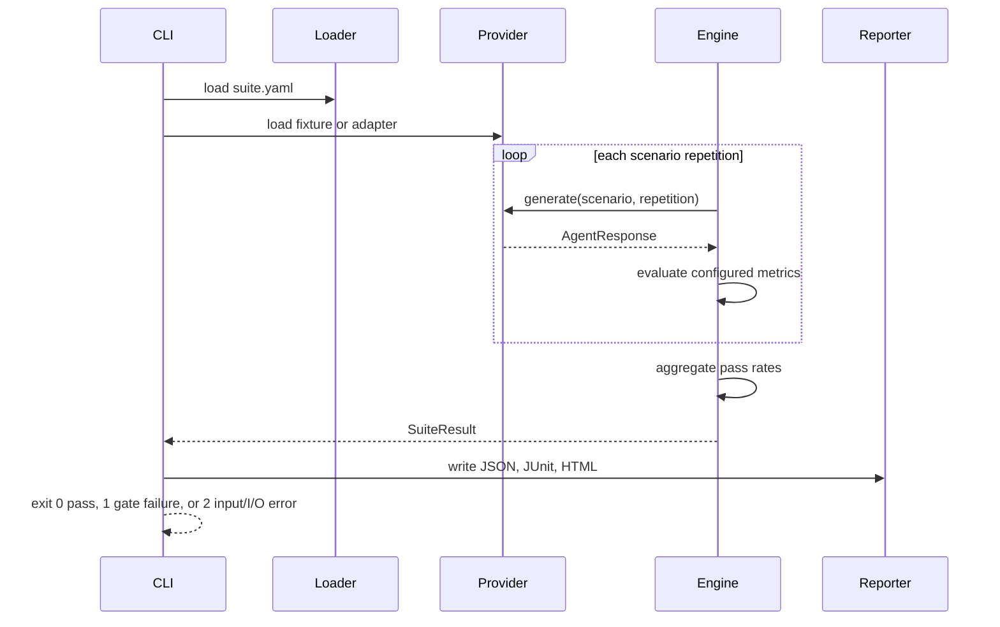

# Architecture

Agent Quality Gate separates agent execution from quality policy. The core never
imports a vendor SDK, which keeps CI deterministic and lets the same scenarios run
against fixtures, local models, hosted APIs, or an organization's own agent.

## Components

### Typed loader

The loader decodes YAML into immutable scenario models. It applies suite defaults
and validates every consumed value without implicit string or numeric coercion.
It rejects empty suites, invalid or non-finite ranges, zero repetitions, duplicate
scenario IDs, contradictory required/allowed tool policy, oversized regex policy,
and invalid regular expressions before execution. Fixture evidence receives the
same strict type, finite-range, and non-empty-response validation.

### Provider contract

`AgentProvider.generate(scenario, repetition)` returns an `AgentResponse` containing:

- response text;
- cited source identifiers;
- tool names and arguments;
- observed latency;
- estimated cost.

`FixtureProvider` replays synthetic responses and cycles deterministically when a
scenario requests more repetitions than the fixture contains.

### Evaluation engine

The engine evaluates each response independently. Metric outputs contain the name,
pass decision, observed score, threshold, and human-readable evidence. A run passes
only when all metrics pass.

### Policy aggregation

A scenario's pass rate is the number of passing repetitions divided by its total
repetitions. The configured `min_pass_rate` determines the scenario decision. The
suite is fail-closed: every scenario must pass.

### Reporters

A single immutable result tree feeds all reporters:

- JSON preserves complete nested evidence;
- JUnit represents scenarios as test cases for CI ingestion;
- HTML provides a portable reviewer summary.

## Data flow

## Extension boundary

A live provider adapter belongs outside the evaluator and should translate its SDK
response into `AgentResponse`. Adapters should implement explicit timeouts, retry
policy, credential handling, and cost accounting. Tests should inject a fake
transport rather than contact external services.

## Trust boundaries

- YAML and fixtures are untrusted inputs. The loader rejects malformed types,
  non-finite or out-of-range numbers, vacuous suites, and contradictory policy.
- Regex patterns can consume excessive CPU even when syntactically valid. Pattern
  count and length are capped, every search has a 20 ms timeout, and timeout fails
  closed; suites should still be reviewed before use in shared CI.
- Provider-reported latency and cost are evidence supplied by the adapter.
- Lexical grounding is deterministic but not semantic verification.
- Tool-name conformance does not authorize or sandbox tool execution.
